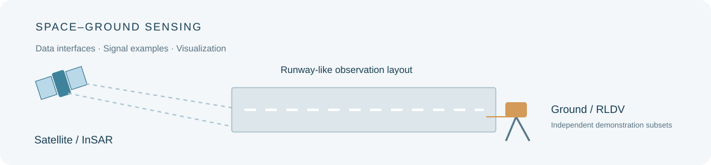
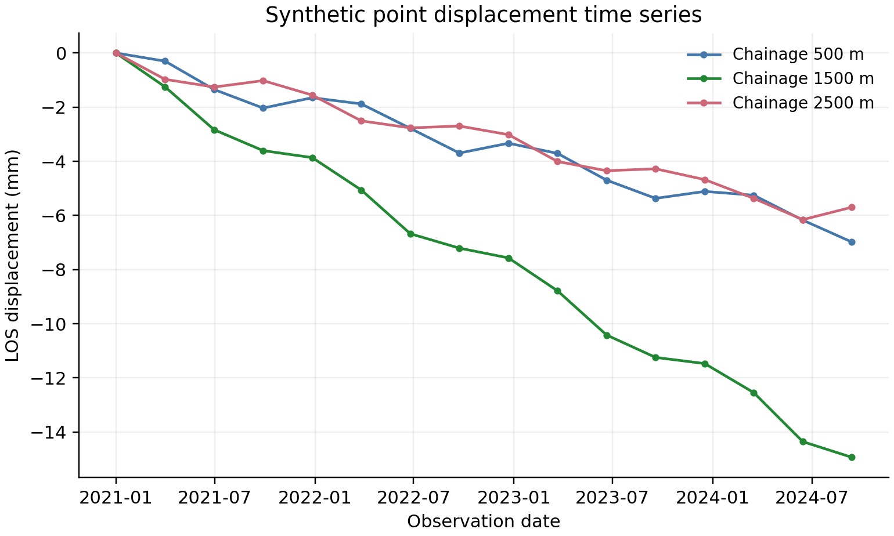

# 星地协同机场跑道表面性状异构感知数据集

**Space–Ground Heterogeneous Sensing Dataset for Airport Runway Surface Characteristics**



面向机场跑道表面性状感知与分析，展示星载遥感与地面振动观测两类异构数据的组织方式、数据接口与可视化示例。

当前公开版本包含 **InSAR 模拟位移序列** 与 **少量地面激光测振实测记录**，按两个独立示例组织。配套程序用于数据读取、基础统计与结果展示。

## 数据组成

| 感知方式 | 示例内容 | 数据入口 |
| --- | --- | --- |
| 卫星侧 InSAR | 模拟点位位移与时序信息 | [卫星侧示例](satellite_insar/README.md) |
| 地面侧 RLDV | 车辆荷载作用下的路面振动速度记录 | [地面侧示例](ground_rldv/docs/README.zh-CN.md) |

## 示例展示




## 使用

Python 3.10 或更高版本：

```bash
python -m pip install -r requirements.txt
python run_demo.py
```

各子目录提供相应的数据说明与示例程序，统一数据索引见 [dataset_manifest.json](dataset_manifest.json)。

## 发布范围

本仓库为展示子集，研究所用的完整数据与核心处理方法保留。公开内容用于了解数据形式、读取接口和基础可视化流程。数据复用条款见 [使用说明](ground_rldv/README.md#reuse)。
