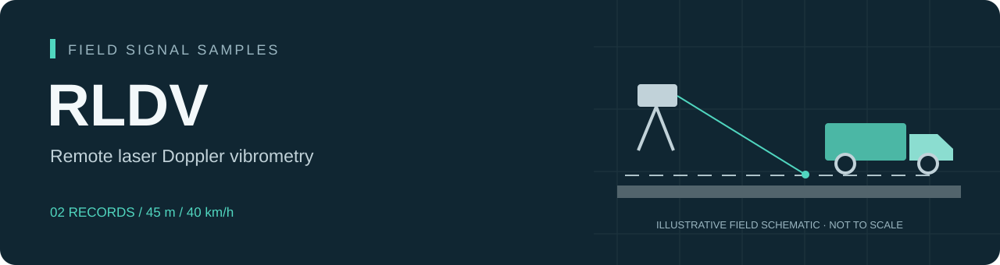
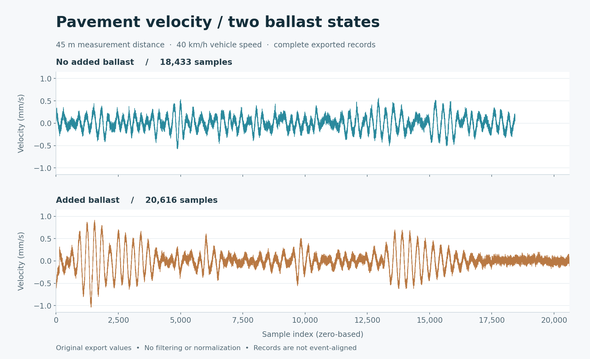

<p align="center">
  
</p>

# Ground Vibration Examples

Selected remote laser Doppler vibrometry records from moving-vehicle tests on concrete pavement. This small subset illustrates exported signal formats and basic waveform visualization.

## Preview



## Use

From the collection root:

```bash
python run_demo.py --source ground
```

The reader loads the selected records and checks them against the supplied manifest. To rebuild the signal preview:

```bash
python ground_rldv/examples/plot_signals.py
```

The text exports retain their supplied numeric values and sample order. Format details are provided in [Data notes](docs/DATA.md); a [Chinese overview](docs/README.zh-CN.md) is also available.

## Reuse

No reuse license has been assigned to this release. Contact the repository owner for reuse terms.
