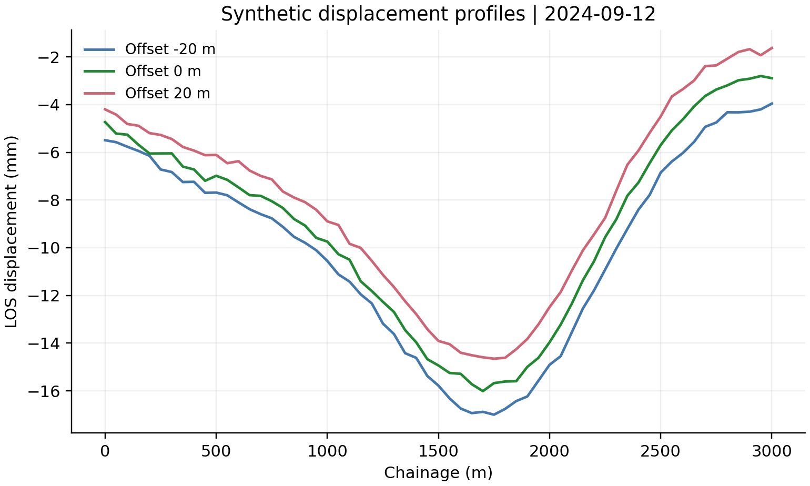

# InSAR Displacement Examples

A compact example of point-based displacement records, basic trend summaries, and visualization for a runway-like layout.

**The included observations are synthetic**, use local coordinates, and serve as a data-interface demonstration. The example code covers general loading, summary statistics, and plotting.

## Preview




## Use

From the collection root:

```bash
python run_demo.py --source satellite
```

Results are written to this subset's `outputs/demo/` directory.

## Data interface

| Field | Description |
| --- | --- |
| `point_id` | Observation point identifier |
| `chainage_m` | Local longitudinal position, m |
| `offset_m` | Local transverse position, m |
| `date` | Observation date |
| `los_displacement_mm` | Relative line-of-sight displacement, mm |

The CSV and example programs illustrate the interface and basic visualization. Complete research inputs and specialized processing methods are retained separately.
